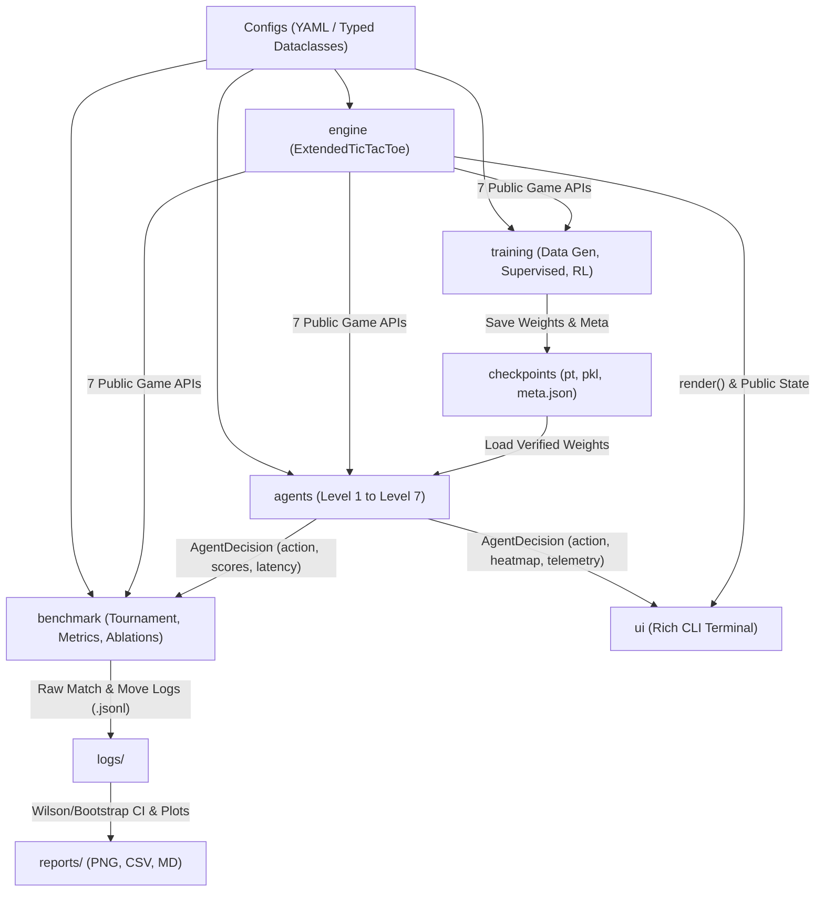
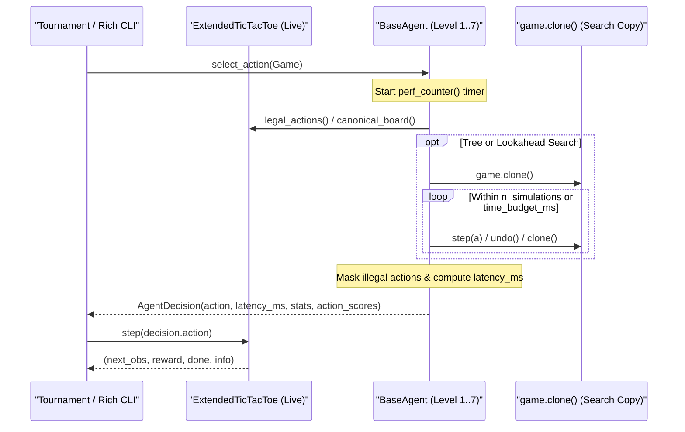
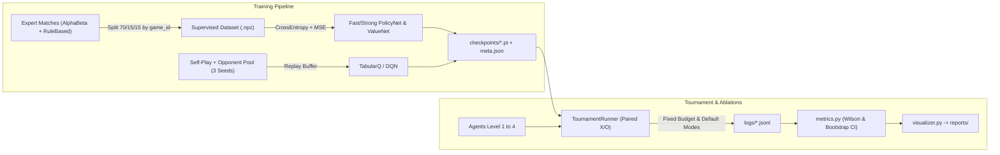

# ARCHITECTURE — Kiến trúc Hệ thống Game AI Đa Cấp Độ (`ttt_ai`)

Tài liệu này mô tả kiến trúc phần mềm mô-đun hóa, hợp đồng chuẩn Game API, thiết kế các lớp thuật toán Cấp 1–7 (bao gồm `Fast/Strong Policy Network`, `Value Network`, `Tabular Q / DQN` và `Hybrid MCTS`), schema dữ liệu/checkpoint và luồng giải đấu Round-Robin công bằng cho trò chơi **Extended Tic-Tac-Toe (`M×N, K`)**.

Tài liệu tuân thủ nghiêm ngặt các yêu cầu và quy tắc trong [PRD.md](./PRD.md) và [RULES.md](./RULES.md).

---

## 1. Tổng quan Kiến trúc Phân lớp & Phụ thuộc

Hệ thống áp dụng kiến trúc phân lớp lỏng (*loosely coupled*), chia làm 5 phân hệ độc lập: **`engine`**, **`agents`**, **`training`**, **`benchmark`**, và **`ui`**.



### Quy tắc ranh giới phụ thuộc (Dependency Boundaries)
1. **`engine/` thuần Python + NumPy:** Tuyệt đối không import `torch`, `rich`, `matplotlib`, hay bất kỳ lớp nào từ `agents/`, `training/`, `benchmark/`, `ui/`.
2. **`agents/` giao tiếp với trò chơi chỉ qua Public Game API:** Mọi tác tử kế thừa `BaseAgent` và chỉ thao tác trạng thái qua `legal_actions()`, `clone()`, `step()`, `undo()`, `is_terminal()`, `result()`, `canonical_board()`.
3. **`src/` layout kết hợp `pyproject.toml`:** Đảm bảo mọi script trong `scripts/`, test trong `tests/`, và notebook phân tích import nhất quán gói `ttt_ai` qua editable install (`pip install -e .`), tránh lỗi đường dẫn tương đối trên Windows.

---

## 2. Cấu trúc Thư mục Dự án

```text
FINAL/
├── Planning/
│   ├── PRD.md                        # Đặc tả bài toán, 3 RQ (RQ3, RQ4, RQ5) & Rubric
│   ├── RULES.md                      # Quy chuẩn PEP 8, API contract & trung thực học thuật
│   ├── ARCHITECTURE.md               # Kiến trúc hệ thống & đặc tả kỹ thuật (tài liệu này)
│   ├── DESIGN.md                     # Thiết kế giao diện Rich CLI & hệ thống biểu đồ
│   ├── TASKS.md                      # Phân rã công việc 5 Sprint
│   └── PROGRESS.md                   # Bảng tiến độ & nhật ký lỗi kỹ thuật
├── References/                       # Tài liệu đề cương, slide, sách & mã nguồn tham khảo
│   ├── TTNTNC_De_tai_cuoi_ky_Game_AI.pdf
│   ├── Tic tac toe Game.pdf
│   ├── 2024 - Liu - AlphaGo Simplified Rule-Based AI and Deep Learning in Everyday Games.pdf
│   ├── AlphaGoSimplified-main/       # Mã nguồn tham khảo sách Mark Liu (chỉ đọc/đối chiếu)
│   └── Reversi-mcts-master/          # Mã nguồn tham khảo MCTS (chỉ đọc/đối chiếu)
├── configs/
│   ├── game_4x4_k4.yaml              # Chuẩn chính (Primary Benchmark)
│   ├── game_4x4_k3.yaml              # Biến thể độ nhạy lợi thế đi trước (RQ4)
│   ├── game_3x3_k3.yaml              # Biến thể đối chứng slide
│   ├── game_5x5_k4.yaml              # Biến thể mở rộng tổng quát hóa (Bonus)
│   ├── train_supervised.yaml         # Cấu hình sinh dữ liệu expert & train Policy/Value Net
│   ├── train_rl.yaml                 # Cấu hình Tabular Q (3x3) & DQN Self-Play (4x4)
│   └── tournament.yaml               # Cấu hình Round-Robin & 4 thí nghiệm Ablation
├── src/
│   └── ttt_ai/
│       ├── __init__.py
│       ├── config.py                 # YAML loader -> Typed Dataclasses & seed_everything()
│       ├── engine/
│       │   ├── __init__.py
│       │   ├── exceptions.py         # IllegalMoveError, InvalidConfigError
│       │   ├── rules.py              # check_win_around O(K), win_windows(), positional_weights()
│       │   └── game.py               # ExtendedTicTacToe cài đặt đầy đủ Game API chuẩn
│       ├── agents/
│       │   ├── __init__.py
│       │   ├── base.py               # BaseAgent, AgentDecision, SearchTimeoutError
│       │   ├── random_agent.py       # Cấp 1: RandomAgent
│       │   ├── rule_based_agent.py   # Cấp 2: RuleBasedAgent (Newell & Simon mở rộng)
│       │   ├── minimax_agent.py      # Cấp 3: Minimax, Alpha-Beta, Heuristic, Iterative Deepening
│       │   ├── mcts_agent.py         # Cấp 4: MCTS UCT (Rollout ngẫu nhiên)
│       │   ├── nn_models.py          # FastPolicyNet, StrongPolicyNet, ValueNet, DQNNet
│       │   ├── policy_agent.py       # Cấp 5: PolicyNetworkAgent & ValueGreedyAgent
│       │   ├── rl_agent.py           # Cấp 6: TabularQAgent (3x3) & DQNAgent (4x4 / MxN)
│       │   └── hybrid_mcts_agent.py  # Cấp 7: HybridMCTSAgent (PUCT + Policy / Value)
│       ├── training/
│       │   ├── __init__.py
│       │   ├── dataset_gen.py        # Sinh dữ liệu expert, loại trùng, chia theo game_id
│       │   ├── train_supervised.py   # Train FastPolicyNet, StrongPolicyNet & ValueNet
│       │   ├── train_q_tabular.py    # Train Tabular Q-learning (3x3, canonical keys)
│       │   ├── train_dqn_selfplay.py # Experience Replay, Target Net, Mixed Opponent Pool
│       │   └── checkpoint_io.py      # Lưu/nạp trọng số kèm meta.json (xác minh đã train)
│       ├── benchmark/
│       │   ├── __init__.py
│       │   ├── tournament.py         # Paired Round-Robin Runner (cân bằng X/O, đa seed)
│       │   ├── metrics.py            # Score, Wilson 95% CI, Bootstrap 95% CI, p95 latency
│       │   ├── ablations.py          # 4 kịch bản Ablation (AB pruning, RQ3, RQ4, RQ5)
│       │   └── visualizer.py         # Xuất Fig 1..5 PNG (300 DPI) & summary CSV/MD
│       └── ui/
│           ├── __init__.py
│           ├── theme.py              # Bảng màu Rich, thang nhiệt heatmap, fallback ASCII
│           └── cli_app.py            # Rich CLI Demo (Human vs AI, AI vs AI, Telemetry)
├── scripts/
│   ├── generate_dataset.py
│   ├── train_all.py
│   ├── run_tournament.py
│   ├── run_ablations.py
│   ├── plot_results.py
│   └── play.py
├── tests/
│   ├── test_engine.py
│   ├── test_agents_contract.py
│   ├── test_search_agents.py
│   └── test_tournament_metrics.py
├── checkpoints/                      # Trọng số + *.meta.json
├── logs/                             # Raw *.jsonl (matches, ablations, training curves)
├── reports/                          # figures/*.png, summary_tables.md, summary_metrics.csv
├── pyproject.toml
└── README.md
```

---

## 3. Thiết kế Chuẩn Game API & Tương tác Tác tử

### 3.1. Lớp `ExtendedTicTacToe` (`src/ttt_ai/engine/game.py`)
Trạng thái bàn cờ lưu bằng mảng 2D `np.ndarray(shape=(M, N), dtype=np.int8)` với `Player.X = 1`, `Player.O = -1`, `EMPTY = 0`, kèm stack `_history` gồm `(action, prev_player)` để thao tác `step()` và `undo()` đạt $O(1)$ không cấp phát bộ nhớ lặp lại trong vòng lặp Alpha-Beta.

| Phương thức | Chữ ký (Signature) | Hành vi & Ràng buộc kỹ thuật |
|---|---|---|
| `reset` | `reset() -> np.ndarray` | Xóa bàn cờ về `0`, đặt lượt đầu `Player.X (+1)`, xóa `_history` và cache kết thúc; trả về bản copy `(M, N)`. |
| `legal_actions` | `legal_actions() -> list[int]` | Trả về danh sách chỉ số `a ∈ [0, M*N - 1]` đang trống theo thứ tự tăng dần; trả về `[]` nếu `is_terminal()` là `True`. |
| `step` | `step(action: int) -> tuple[np.ndarray, float, bool, dict[str, Any]]` | Kiểm tra `not is_terminal()`, `0 <= action < M*N`, và ô trống (nếu sai ném `IllegalMoveError`). Cập nhật bàn cờ, gọi `check_win_around` $O(K)$, kiểm tra hòa khi `len(_history) == M*N`, đổi lượt nếu chưa kết thúc. |
| `is_terminal` | `is_terminal() -> bool` | Trả về `True` khi có người thắng hoặc bàn cờ đầy. |
| `result` | `result(player: int \| None = None) -> float \| None` | Trả về `None` nếu chưa kết thúc; `0.0` nếu hòa; `+1.0` nếu người thắng trùng `player` (mặc định `Player.X`), ngược lại `-1.0`. |
| `render` | `render() -> str` | Trả về lưới ASCII kèm chỉ số hàng/cột và đường thắng (nếu có) để ghi log hoặc debug. |
| `clone` | `clone() -> ExtendedTicTacToe` | Sao chép sâu toàn bộ bàn cờ, lịch sử và trạng thái terminal để cây MCTS khám phá độc lập. |
| `undo` | `undo() -> None` | Hoàn tác nước đi gần nhất từ stack lịch sử trong $O(1)$ (ném `IllegalMoveError` nếu lịch sử rỗng), khôi phục chính xác trạng thái trước đó. |

**Các hàm hỗ trợ dùng chung trong `engine/rules.py`:**
- `check_win_around(board, row, col, player, win_k) -> list[tuple[int, int]] | None`: Kiểm tra 4 trục quanh `(row, col)` trong $O(K)$; trả về danh sách tọa độ `K` ô thắng (dùng để tô sáng đường thắng trên Rich CLI) hoặc `None`.
- `encode_canonical_board(board, current_player) -> np.ndarray`: Nhân `board * current_player` để đưa mọi bàn cờ về góc nhìn thống nhất `+1` (ta) / `-1` (đối thủ) / `0` (trống) (theo slide 38).
- `precompute_win_windows(rows, cols, win_k) -> tuple[tuple[int, ...], ...]`: Tiền tính toàn bộ các cửa sổ thẳng/chéo có độ dài `K` một lần duy nhất khi khởi tạo cấu hình bàn cờ; dùng chung cho ma trận trọng số vị trí (Cấp 2) và hàm lượng giá heuristic (Cấp 3).

### 3.2. Giao ước Tác tử & Luồng Thực thi một Nước đi

```python
@dataclass(slots=True)
class AgentDecision:
    action: int
    latency_ms: float
    nodes_visited: int = 0
    simulations: int = 0
    depth_reached: int = 0
    value_estimate: float | None = None
    action_scores: dict[int, float] = field(default_factory=dict)
    prior_probs: dict[int, float] = field(default_factory=dict)
```

- Trường `prior_probs` (tùy chọn, dùng cho Cấp 7 `HybridMCTS`) lưu xác suất tiên nghiệm $P(s, a)$ từ mạng Policy song song với phân phối lượt thăm sau tìm kiếm `action_scores`, cho phép Rich CLI và script phân tích chứng minh trực quan cách tìm kiếm cây điều chỉnh gợi ý mạng nơ-ron (**RQ3**).



---

## 4. Kiến trúc Chi tiết các Cấp độ Tác tử AI (Cấp 1 – 7)

### 4.1. Cấp 1 – 4: Baseline & Tìm kiếm Đối kháng Cổ điển
- **Cấp 1 (`RandomAgent`):** Dùng `np.random.Generator` riêng gắn theo `seed` để tái lập tuyệt đối.
- **Cấp 2 (`RuleBasedAgent`):** 6 tầng luật ưu tiên từ cao xuống thấp: *(1) Thắng ngay* $\rightarrow$ *(2) Chặn thắng ngay* $\rightarrow$ *(3) Tạo thế đôi (từ 2 cửa sổ mở đạt $K-1$ quân sau 1 nước)* $\rightarrow$ *(4) Chặn thế đôi đối phương* $\rightarrow$ *(5) Ô có `positional_weight` cao nhất (số cửa sổ thắng $K$ đi qua ô)* $\rightarrow$ *(6) Ngẫu nhiên có kiểm soát*.
- **Cấp 3 (`MinimaxAgent` / `AlphaBetaAgent`):**
  - Thao tác `step()`/`undo()` trên một bản `game.clone()` duy nhất tại gốc.
  - **Cơ chế Kiểm soát Ngân sách Thời gian (`time_budget_ms`):** Áp dụng **Iterative Deepening** (`depth = 1, 2, ..., max_depth`). Bên trong đệ quy, kiểm tra `time.perf_counter() >= deadline` mỗi `256` nút duyệt; nếu chạm deadline, ném nội bộ `SearchTimeoutError` để hủy nhánh chưa hoàn tất và trả về `best_action` của độ sâu hoàn chỉnh gần nhất (nếu chưa xong depth 1, fallback sang `MoveOrdering` tốt nhất).
  - **Hàm lượng giá Heuristic (`evaluate_board`):** Duyệt qua `precompute_win_windows(M, N, K)`. Mọi cửa sổ chỉ chứa quân của một phe (cửa sổ mở) được cộng/trừ điểm theo $10^{c - 1}$ với $c$ là số quân đã đặt trong cửa sổ; kết quả chuẩn hóa về khoảng `(-1.0, +1.0)` bằng `tanh` để không lẫn với điểm thắng/thua tuyệt đối `±10.0`.
  - Hỗ trợ cờ `use_alpha_beta: bool` và `use_move_ordering: bool` phục vụ Ablation 1.
- **Cấp 4 (`MCTSAgent` — UCT):**
  - Selection theo UCT: $Q(s,a) + c_{\text{uct}} \sqrt{\frac{\ln N(s)}{N(s,a)}}$ (ưu tiên chọn các nhánh chưa thăm trước).
  - Expansion mở 1 nhánh chưa thăm; Simulation rollout ngẫu nhiên đồng đều đến terminal; Backpropagation đảo dấu phần thưởng theo từng tầng người chơi.
  - Hỗ trợ dừng theo `n_simulations` hoặc `time_budget_ms` (kiểm tra đồng hồ sau mỗi simulation).

### 4.2. Cấp 5: Mạng Học Có Giám Sát (`FastPolicyNet`, `StrongPolicyNet`, `ValueNet`)
Tổng quát hóa kiến trúc từ slide 44–48 và slide 61–62 của `Tic tac toe Game.pdf` sang đầu vào tổng quát `(B, 1, M, N)`:

| Mô hình | Backbone CNN | MLP Ẩn | Đầu ra & Hàm Loss | Vai trò |
|---|---|---|---|---|
| `FastPolicyNet` | `Conv2d(1, 128, 3, padding=1) + ReLU` | `Linear(128*M*N, 64)` $\rightarrow$ `Linear(64, 64)` | `Linear(64, M*N)` logits (`CrossEntropyLoss`) | Suy luận cực nhanh; đối chứng kích thước mạng |
| `StrongPolicyNet` | `Conv2d(1, 128, 3, padding=1) + ReLU` | `3 × Linear(64) + ReLU` | `Linear(64, M*N)` logits (`CrossEntropyLoss`) | Policy chính & làm prior $P(s, a)$ cho Cấp 7 |
| `ValueNet` | `Conv2d(1, 128, 3, padding=1) + ReLU` | `Linear(128*M*N, 64)` $\rightarrow$ `Linear(64, 64)` | `Linear(64, 1) + Tanh` (`MSELoss` với outcome $z \in [-1, +1]$) | Đánh giá trạng thái độc lập (slide 61–62) & hỗ trợ nhánh Value trong Cấp 7 (RQ3) |

- **Action Masking bắt buộc:** Khi `PolicyNetworkAgent` suy luận, mọi ô không nằm trong `legal_actions()` bị gán `logits = -1e9` trước khi `Softmax`. Khi `ValueGreedyAgent` (dùng `ValueNet` thuần để đối chiếu slide 61–62) chọn nước đi, agent duyệt các nước hợp lệ `clone/step` 1 bước và chọn nước có $-V(s')$ lớn nhất.

### 4.3. Cấp 6: Reinforcement Learning (`TabularQAgent` & `DQNAgent`)
- **`TabularQAgent` (Cho `3×3, K=3` — đối chứng slide 56):** Khóa trạng thái là byte string của `canonical_board`; cập nhật Q-value cho trò chơi zero-sum theo phương trình $Q(s,a) \leftarrow (1-\alpha) Q(s,a) + \alpha \cdot [r - \gamma \max_{a' \in \text{legal}(s')} Q(s', a')]$ (đảo dấu vì lượt kế là của đối thủ).
- **`DQNAgent` (Cho `4×4, K=4`, `4×4, K=3` & tổng quát `M×N` — phục vụ RQ5):**
  - Mạng `DQNNet`: `Conv2d(1, 128, 3, padding=1) + ReLU` $\rightarrow$ `2 × Linear(64) + ReLU` $\rightarrow$ `Linear(M*N)` ước lượng Q-values.
  - **Ổn định hóa Self-Play:**
    1. *Experience Replay Buffer* (dung lượng cấu hình, ví dụ `50,000` transitions) lưu tuple `(s_canon, a, r_terminal, s_next_canon, done, legal_mask_next)`.
    2. *Target Network* cập nhật cứng mỗi `target_update_steps` (hoặc soft Polyak $\tau$).
    3. *Masked Zero-Sum Bellman Target:* Với `done=True`, $y = r_{\text{terminal}}$; với `done=False`, $y = -\gamma \max_{a' \in \text{legal}(s')} Q_{\text{target}}(s', a')$.
    4. *Mixed Training Opponent Pool:* Kết hợp 70% tự chơi với bản snapshot quá khứ của chính nó (cập nhật pool theo chu kỳ) + 30% đối thủ baseline (`Random`/`RuleBased`) để ngăn quên thảm họa (*catastrophic forgetting*).

### 4.4. Cấp 7: `HybridMCTSAgent` — AlphaGo-inspired (`src/ttt_ai/agents/hybrid_mcts_agent.py`)
Kiến trúc mô phỏng cảm hứng AlphaGo phục vụ trực tiếp **RQ3**, hỗ trợ chọn chế độ đánh giá nút lá (`leaf_eval_mode`) để thực nghiệm có kiểm soát:
1. **Selection (PUCT):** Tại nút đã mở rộng, chọn $a$ tối đa hóa:
   $$\text{PUCT}(s, a) = Q(s, a) + c_{\text{puct}} \cdot P(s, a) \cdot \frac{\sqrt{\sum_{b} N(s, b)}}{1 + N(s, a)}$$
2. **Expansion & Prior Caching:** Khi mở rộng nút mới $s$, gọi `StrongPolicyNet` lấy phân phối $P(s, \cdot)$ đã mask hợp lệ. Kết quả $(P(s,\cdot), V(s))$ được lưu vào **LRU Cache theo `(canonical_board.tobytes())`** để giảm triệt để độ trễ suy luận PyTorch trên các trạng thái lặp lại do hoán vị nước đi (*transpositions*).
3. **Leaf Evaluation (2 cấu hình phục vụ RQ3):**
   - `rollout`: Rollout ngẫu nhiên đến terminal (chuẩn `Mix_MCTS` dùng Policy prior + Rollout).
   - `mixed`: Kết hợp $\lambda \cdot V_\theta(s) + (1 - \lambda) \cdot z_{\text{rollout}}$ với $V_\theta(s)$ từ `ValueNet` (mô phỏng đầy đủ cả Policy + Value trong AlphaGo-inspired).
4. **Backpropagation:** Lan truyền ngược kết quả lên gốc theo dấu luân phiên từng tầng.

---

## 5. Schema Dữ liệu, Checkpoint & Luồng Giải đấu Công bằng

### 5.1. Luồng End-to-End (Training & Evaluation)



### 5.2. Schema Checkpoint Metadata (`checkpoints/<name>.meta.json`)
Ngăn chặn tuyệt đối việc dùng nhầm trọng số chưa huấn luyện hoặc sai cấu hình bàn cờ:
```json
{
  "agent_class": "StrongPolicyNet",
  "board_config": {"rows": 4, "cols": 4, "win_k": 4},
  "seed": 42,
  "training_type": "supervised",
  "dataset_hash": "sha256:...",
  "split_policy": "game_id_70_15_15",
  "epochs_trained": 60,
  "best_val_loss": 0.612,
  "best_val_accuracy": 0.748,
  "training_time_sec": 142.5,
  "hardware": {"device": "cpu", "python": "3.11"},
  "weights_sha256": "..."
}
```
Khi khởi tạo `PolicyNetworkAgent`, `DQNAgent` hoặc `HybridMCTSAgent`, `checkpoint_io.py` tự động kiểm tra khớp `board_config` và sự tồn tại hợp lệ của `meta.json`.

### 5.3. Thiết kế Giải đấu & Schema Raw Log (`logs/*.jsonl`)
- **Paired Round-Robin:** Với mỗi cặp `(A, B)` và ngân sách `N = 200` ván, chạy `100` cặp seed `s_0..s_99`; mỗi cặp gồm 1 ván `(X=A, O=B)` và 1 ván `(X=B, O=A)` để loại bỏ sai số thứ tự và tạo dữ liệu sạch cho **RQ4**.
- **Hai chế độ thực nghiệm bắt buộc:**
  1. **Fixed Budget Mode:** Cố định `time_budget_ms ∈ {10.0, 50.0}` cho các tác tử tìm kiếm; riêng nhánh Ablation RQ3 chạy thêm theo `n_simulations ∈ {50, 150, 400}`.
  2. **Default Mode:** Thông số mặc định minh bạch từ `configs/tournament.yaml`.
- **Schema dòng JSONL:**
  - Dòng 1 (`type="meta"`): Ghi thông tin bàn cờ, chế độ ngân sách, cấu hình tất cả agent, phiên bản phần mềm và thông số phần cứng (CPU/GPU/RAM).
  - Các dòng tiếp theo (`type="match"`): Ghi `match_id`, `pair_id`, `seed`, `agent_x`, `agent_o`, `winner` (`1`, `-1`, `0`), `score_x`, `score_o`, `num_moves`, `latencies_x_ms`, `latencies_o_ms`, `nodes_x`, `nodes_o`, và danh sách `moves` (`[action, latency_ms, nodes, sims, depth]`) để truy xuất ngược lại mọi ván thua/sai lầm khi phân tích.
- **Tính toán Thống kê (`metrics.py`):**
  - `score = (wins + 0.5 * draws) / total_games`.
  - **Wilson Score 95% CI** cho tỷ lệ thắng và **Bootstrap 95% CI (10,000 mẫu lặp)** cho `score` và $\Delta\text{Score} = \text{Score}_X - \text{Score}_O$.
  - Độ trễ nước đi (`mean_ms`, `p95_ms`, `max_ms`) tổng hợp ở mức từng nước đi trên toàn bộ ván đấu.
